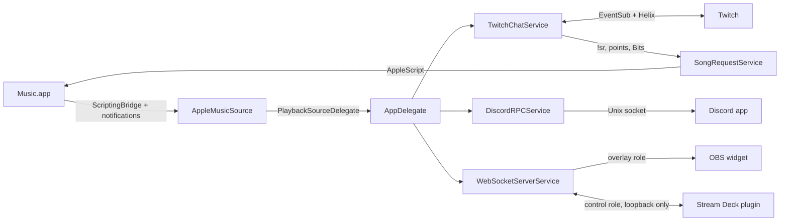

**TL;DR:** one menu bar app reads Apple Music, then fans the current song out to Twitch chat, Discord, and a local WebSocket.
This page maps the code for contributors. To build it, start with [Development](/docs/development).

- **Pattern:** MVVM + services, with an `NSApplicationDelegateAdaptor` lifecycle.
- **Stack:** Swift 6, SwiftUI, AppKit, macOS 26+. Sparkle is the only third-party dependency.

## How data flows



1. `AppleMusicSource` notices a track change.
2. It tells `AppDelegate` through `PlaybackSourceDelegate`.
3. `AppDelegate` hands the song to each enabled service.
4. Chat commands and paid events flow back in through `TwitchChatService` and `SongRequestService`.

## Project structure

- App code: [`apps/native/WolfWave/`](https://github.com/MrDemonWolf/wolfwave/tree/main/apps/native/WolfWave)
- Unit and integration tests: [`apps/native/WolfWaveTests/`](https://github.com/MrDemonWolf/wolfwave/tree/main/apps/native/WolfWaveTests)
- UI tests: [`apps/native/WolfWaveUITests/`](https://github.com/MrDemonWolf/wolfwave/tree/main/apps/native/WolfWaveUITests)

```
WolfWave/
├── WolfWaveApp.swift      # @main app + the AppDelegate class
├── Core/                  # Constants, Keychain, logging, preferences, crash reporter,
│   │                      # AppDelegate+* extensions (MenuBar, MenuSections, DockMenu,
│   │                      # Services, Notifications, TwitchTokenValidation, Windows, StreamDeck)
│   ├── DesignSystem/      # Tokens.generated.swift (DSColor, DSFont, DSSpace, …)
│   └── ListeningHistory/  # Play log store, records, lifetime tally
├── Monitors/              # AppleMusicSource + PlaybackSourceDelegate
├── Services/
│   ├── Discord/           # DiscordRPCService (+IPC, +FrameIO, +Presence, +TempDirectory), DiscordPresenceBuilder
│   ├── ListeningHistory/  # Opt-in play log service, stats, Monthly Wrap
│   ├── Notifications/     # Opt-in macOS banners
│   ├── SettingsBackup/    # Export/import + opt-in iCloud sync
│   ├── SongRequest/       # Request pipeline, queue, resolvers, AppleMusicController, blocklist, vote-skip
│   ├── Twitch/            # TwitchChatService + seam files, channel points, Helix, device auth, outbox
│   │   └── Commands/      # Bot commands, dispatcher, cooldowns, custom commands
│   ├── UpdateChecker/     # SparkleUpdaterService, UpdateChannel
│   ├── WebSocket/         # WebSocketServerService, WidgetHTTPService, StreamDeckCommand, auth tokens
│   └── *.swift            # ArtworkService, ArtworkTint, LaunchAtLoginService
├── Views/                 # SwiftUI settings shell, one folder per pane, Onboarding/, Shared/, Debug/
└── Resources/             # widget.html, widget-tokens.generated.js, Assets.xcassets,
                           # AppIcon.icon, AppIcon-Dev.icon, dev-appcast.xml
```

The file-by-file list lives in the [Source layout section of `CLAUDE.md`](https://github.com/MrDemonWolf/wolfwave/blob/main/CLAUDE.md#source-layout-appsnativewolfwave).
It's kept there so this page doesn't rot on every PR.

## Patterns

### Delegation

`PlaybackSourceDelegate` carries track updates: name, artist, album, duration, and elapsed time.

### MVVM with `@Observable`

- View models use the `@Observable` macro, not `ObservableObject` / `@Published`.
- `TwitchViewModel` owns Twitch sign-in and connection state. Its user-facing errors are built in `Views/Twitch/TwitchFailure.swift`.
- `OnboardingViewModel` drives the first-run wizard.

### Concurrency

- Swift async/await throughout. No `DispatchQueue` for new async work.
- The module defaults to `MainActor` isolation.

### Loose coupling

Settings changes (for example `TrackingSettingChanged`, `DockVisibilityChanged`) travel over `NotificationCenter`.
Names live in `AppConstants.Notifications`.

### Thread safety

| Component | How it stays safe |
|---|---|
| `TwitchChatService` | Actor isolation. Small lock-backed snapshots for synchronous readers |
| `DiscordRPCService` | Serial `ipcQueue` + `enabledLock` |
| `WebSocketServerService` | Actor-confined listener and state. An `NSLock` guards only UI snapshots |
| `Logger` | Serial `DispatchQueue` for file writes |
| Tray and Dock menus | Read the in-memory `TwitchMenuState`, refreshed off the main thread. They never read the Keychain |

## Key components

### KeychainService

Stores every credential in the macOS Keychain. Never `UserDefaults`, never plain files.

- Twitch access token, refresh token, username, user ID, and channel are **one versioned record**. An account change is a single crash-safe write.
- Old per-field records migrate copy-first. The old ones are deleted only after the new write succeeds.
- A channel restored from a backup is only a hint until Twitch sign-in confirms it.
- Keys live in `AppConstants.Keychain`.

### AppleMusicSource

Reads what Music.app is playing.

- **PID-targeted ScriptingBridge.** It never launches a quit Music.app.
- **Distributed notifications** for instant updates, with event deduplication.
- **5-second fallback poll**, slower in Low Power Mode.
- **Pause keeps the track.** Paused, fast-forward, and rewind still report the loaded song. Only stopped or empty clears it.

### TwitchChatService

An actor that talks to Twitch.

- **EventSub WebSocket** receives chat, channel points, Bits, and stream online/offline.
- **Helix API** sends chat messages and announcements.
- **OAuth Device Code flow** for sign-in. See [Security](/docs/security#twitch-authentication).
- **Network path monitoring** reconnects when the network comes back.
- **Back-off** goes through `Core/RetryAfter.swift`. Invalid `Retry-After` values are rejected and every wait caps at 300 seconds.
- **Split into seam files** (`TwitchChatService+Auth`, `+Connection`, `+EventSub`, `+Sending`, `+RateLimiter`, `+Redemptions`, and more). Stored properties stay in `TwitchChatService.swift`.

#### Paid events never get lost

Channel points and Bits go through `TwitchRedemptionResolutionOutbox`, a disk-backed outbox.

1. A channel-point redemption is saved **before** any song lookup.
2. It's replaced with the known result (fulfill or refund) **before** WolfWave tells Twitch.
3. A qualifying Bits cheer saves its full boost or request action before touching the queue.
4. After a crash or relaunch, unknown point redemptions are refunded and known outcomes replay.

If the outbox can't save, WolfWave pauses the managed reward rather than take points it can't track.

### SongRequestService

Runs the song-request pipeline for chat, channel points, and Bits.

- **One entry point:** `processRequest(query:username:source:)`. Every source shares the same checks.
- **Resolvers:** `SongSearchResolver` (MusicKit search) and `LinkResolverService` (Apple Music links, plus Spotify and YouTube links via their public oEmbed endpoints).
- **Queue:** `SongRequestQueue`. Fair-share round-robin, Sub/VIP priority within rounds, hold mode, buffering while Music.app is closed.
- **Playback:** `AppleMusicController` plays tracks through AppleScript and puts focus back where it was.
- **Blocklist:** `SongBlocklist` blocks songs, artists, or requesters. An artist block also matches inside a collaboration.
- **Approval screening:** opt-in. Every request waits until the broadcaster approves or declines it.
- **Skip:** `skip()` reports `started`, `drained`, `busy`, or `retained`, so `!skip` only says "queue empty" when it really is.
- **Vote-skip:** `SkipVoteManager` runs chat tallies or Twitch Polls.

### BotCommandDispatcher

Routes chat messages to commands.

- Built-ins register in `registerDefaultCommands()`. Each implements `BotCommand` or `AsyncBotCommand`.
- Streamer-made commands (`CustomBotCommand`) are rebuilt per message, so edits apply on the next chat line.
- `CooldownManager` enforces global and per-user cooldowns. Mods bypass them.
- A command can refuse a caller **before** claiming the cooldown (`PreflightCheckedCommand`, used by `!sr`). A refused viewer never starts everyone else's cooldown.
- Replies cap at 500 characters, counted in Unicode scalars like Twitch counts, without splitting an emoji.

To add a command: implement `BotCommand`, register it in `registerDefaultCommands()`, add tests, and update [Bot Commands](/docs/bot-commands).

### DiscordRPCService

Shows "Listening to WolfWave" on your Discord profile.

- **Local IPC socket** at `$TMPDIR/discord-ipc-{0..9}`. No bot token, no server.
- **Album art** comes from the shared `ArtworkService` (iTunes Search API), cached in memory and in `Application Support/WolfWave/Cache/artwork-links.json`.
- **Auto-reconnect** with back-off when Discord quits or restarts.
- **Sandbox-friendly** through SBPL entitlements.
- Payloads are built by the pure `DiscordPresenceBuilder`.

#### Paused state

Discord has no "paused" flag, so WolfWave changes two things while Music is paused:

1. It drops the `timestamps` block, so Discord stops the progress ticker.
2. It swaps `assets.small_image` from `apple_music` to `pause`, with `small_text` set to `"Paused"`.

Track text, the large image, and buttons stay the same. Fork maintainers must upload the art assets; see [Development](/docs/development#rich-presence-art-assets-fork-maintainers).

### WebSocketServerService

The local WebSocket server for OBS and Stream Deck.

- **Network.framework `NWListener`** on the configured port (`8765` by default), all interfaces.
- **Two roles**, picked by the subprotocol a client sends:
  - `wolfwave.overlay.<hex>`: read-only. Loopback or LAN.
  - `wolfwave.control.<hex>`: may send commands. Literal loopback only.
- **Broadcasts** `welcome`, `now_playing`, `progress`, `playback_state`, `overlay_visibility`, `widget_config`, `queue_upcoming`, `queue_state`, and `health`.
- **Commands** are decoded by the pure `StreamDeckControl.parse` and run by the router in `AppDelegate+StreamDeck`. Every command gets an `ack`.
- **Progress** ticks once a second, and only while enabled, playing, overlay-visible, and serving clients.
- **Limits:** inbound frames over 16 KiB are rejected; unauthenticated peers time out after 10 seconds.
- **Auto-retry:** a failed listener restarts after 5 seconds while enabled.

Protocol details: [Stream Deck Control API](/docs/stream-deck). Auth details: [Security](/docs/security#websocket-server-security).

### WidgetHTTPService

A tiny HTTP server that hands the widget to OBS. It starts and stops with the WebSocket server.

- Listens on all interfaces, port `8766` by default.
- `GET /` returns the bundled `widget.html`.
- `/widget-tokens.generated.js`, `/favicon.ico`, and `/favicon.png` are also served. Everything else is `404`.
- Only loopback requests with a literal local `Host` get the overlay token injected, with `Cache-Control: no-store`.

`widget.html` is generated from `apps/widget/`. See [OBS Widget](/docs/widget).

### Stream Deck plugin (`apps/streamdeck/`)

The Elgato plugin that uses the control role. It's a separate bun workspace.

- Bundled for Node into `com.mrdemonwolf.wolfwave.sdPlugin/bin/plugin.js`.
- **Not committed and not shipped in the app.** It's distributed through Elgato.
- Always connects to `127.0.0.1`. Remote hosts are not supported.

| File | Job |
|---|---|
| `src/wolfwave/protocol.ts` | Wire format. Mirrors `StreamDeckCommand.swift`: same action tokens, same `PROTOCOL_VERSION` |
| `src/wolfwave/state.ts` | Pure reducer from frames to key state. Unchanged state returns the same object, so keys don't repaint every second |
| `src/wolfwave/client.ts` | One shared socket, capped reconnect back-off, ack matching. Tells "refused" apart from "not running" |
| `src/connection-status.ts` | Pure mapping from client state to the Property Inspector message |
| `src/actions/` | One class per key over a shared base that paints offline / unauthorized / outdated states |

Change `StreamDeckCommand.swift`? Change `protocol.ts` in the same PR. CI fails if they drift.
Setup for streamers is on the [Stream Deck](/docs/streamdeck) page.

### SparkleUpdaterService

- **EdDSA-signed appcast**, checked against `SUPublicEDKey` in `Info.plist`.
- **Release builds** check `SUFeedURL`. Stable and Nightly feeds come from `UpdateChannel`.
- **Debug builds** don't check on their own. **Check Now** reads the bundled `dev-appcast.xml`.
- **Homebrew installs** turn Sparkle off. Homebrew handles updates.

## Next steps

<Cards>
  <Card title="Development" href="/docs/development" description="Build, test, and open a PR." />
  <Card title="Stream Deck Control API" href="/docs/stream-deck" description="The command envelope and live state frames." />
  <Card title="Security" href="/docs/security" description="Keychain, sandbox, and the WebSocket auth model." />
</Cards>
