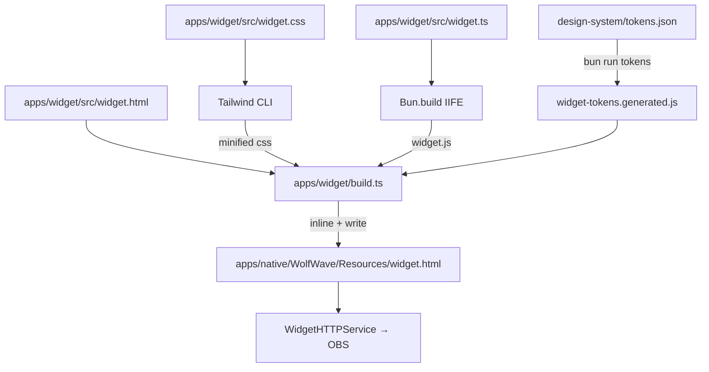

**TL;DR:** the OBS overlay is one self-contained `widget.html`, built from `apps/widget/` and served by WolfWave to an OBS Browser Source.
This page is for developers changing the widget or reading its message feed.

Just want the overlay on stream? In **Settings → Stream Widgets**, turn on **Enable Stream Widgets**, then **Enable Widget Webpage**, then click **Copy Link** and paste it into OBS as a Browser Source. See [Features](/docs/features) and [Settings](/docs/settings).

- **Shipped file:** `apps/native/WolfWave/Resources/widget.html`. `WidgetHTTPService` serves it.
- **Don't edit it by hand.** It's generated from the Tailwind + TypeScript workspace at `apps/widget/`.
- **Xcode doesn't rebuild it.** Xcode bundles the committed file. You (or CI) rebuild it with bun.

## Architecture



Everything lands in one HTML file: `<style>`, the tokens `<script>`, and the
runtime `<script>` all inlined. No external `<link>` and no `<script src>`: even
the favicon is a `data:` URI, so there are no extra HTTP round-trips. The
supported path is the local HTTP URL exposed by WolfWave, which also bootstraps
the authenticated WebSocket connection.

## Message contract

The browser widget consumes the server-to-client messages from the shared
WebSocket service. The widget itself is receive-only. Schemas are frozen by the
test suite. Adding fields server-side is safe; renaming fields requires a
coordinated change.

| Type | Payload | Cadence |
|------|---------|---------|
| `welcome` | `{ server, version }` (top-level fields, no `data`) | Once on connect |
| `now_playing` | `{ track, artist, album, duration, elapsed, isPlaying, artworkURL }` | Track change, pause or resume, late artwork, and on connect |
| `progress` | `{ elapsed, duration, isPlaying }` | About once a second while playing (every 3 s in Low Power Mode or when the Mac runs hot) |
| `playback_state` | `{ isPlaying, track?, artist?, album? }` | Playback stops or clears. Also on connect when nothing is loaded |
| `overlay_visibility` | `{ visible }` | On connect, and on each Stream Deck visibility toggle |
| `widget_config` | `{ theme, layout, textColor, backgroundColor, fontFamily }` | On connect, and when you click **Apply** in Widget Appearance |
| `queue_upcoming` | `{ items: [{ title, requesterUsername }] }` (max 3) | On connect, and on queue change |

The browser widget never sends back. The native app pushes, the browser renders.

**Connecting from your own code.** Open `ws://<host>:<port>` (default port `8765`, set in **Settings → Stream Widgets → Build your own overlay**) and offer the subprotocol `wolfwave.overlay.<token>` in `Sec-WebSocket-Protocol`. The **Overlay Token** is in the same card. WolfWave reads only the subprotocol, so a `?token=` query on the WebSocket URL doesn't authenticate. A wrong or missing token fails the handshake.

When the connection drops, the widget clears its card and reconnects. If the browser hides or suspends the page (`visibilitychange`, `pagehide`), it drops the socket on purpose and waits for a fresh snapshot after it returns, so a track that stopped in the meantime doesn't flash back onto the stream.

The server also broadcasts `queue_state` and `health` to every client. The widget ignores them; they're for [Stream Deck](/docs/stream-deck#live-state-frames).

### Control API

The same listener also exposes a separate, loopback-only control role for Stream
Deck. The widget's overlay credential is read-only and cannot send commands.
The command protocol lives on the [Stream Deck page](/docs/stream-deck).

## Paused playback

When Music.app reports the loaded track as paused (`kPSp`), the widget stays
on stream. The card is **not** hidden. Instead:

- The widget root gains the `.is-paused` class
- Album artwork drops to ~55% opacity with reduced saturation
- A pause glyph overlays the artwork
- The progress loop suspends, so the bar freezes the moment pause arrives

Playback clears the card only on a genuine "track cleared" event (Music.app
quits, permission revoked, or tracking disabled). Hitting pause keeps the song
context visible so chat knows the integration is still healthy.

## Themes and layouts

**Five themes, five layouts, ready to go.** They live in
`design-system/tokens.json` under `widget.themes` and `widget.layouts`.

The selectable themes are Default, Dark, Light, Glass, and Neon. The widget adds
16 px of transparent padding on every side, so size the OBS Browser Source 32 px
larger than the generated card:

| Layout | Generated card | Recommended OBS canvas |
|---|---:|---:|
| Horizontal | 500 × 100 | 532 × 132 |
| Vertical | 220 × 280 | 252 × 312 |
| Compact | 350 × 56 | 382 × 88 |
| Vinyl | 260 × 300 | 292 × 332 |
| Classic | 440 × 112 | 472 × 144 |

Vinyl is a spinning record with the album art as its label and a circular
progress ring; Classic is an album tile beside a card with title, artist, and a
progress bar.

`tokens.json` also defines a `WolfWave` theme marked `hidden`. It's left out of
the picker (`DSWidgetThemes.order` in the generated Swift), so the app exposes
five selectable themes.

**Swap themes without rebuilding.** Themes aren't compiled into utility
variants. They arrive at runtime over the WebSocket as `widget_config` messages.
Pick a theme or layout in **Settings → Stream Widgets → Widget Appearance**,
check the preview, then click **Apply** (or press Command-S). The overlay
restyles live. No URL edit, no rebuild, no OBS refresh.

**Preview before you commit.** The **Widget Appearance** card shows a live
preview below the controls. Change a theme, layout, font, or color and the
preview updates as you go, so you can dial in the look before it reaches OBS.
The preview is a draft: nothing reaches OBS until you click **Apply**
(Command-S), and **Revert** throws the draft away. Default and Glass expose the
Text and Background color pickers; the other themes ship fixed palettes.

**URL parameters:**

| Parameter | What it does |
|---|---|
| `?token=<hex>` | LAN bootstrap token; the widget forwards it when opening the WebSocket. Loopback pages receive the token in the served HTML instead. |
| `?port=8765` | WebSocket port the widget connects to (1-65535, default `8765`). WolfWave's copied links add it for you when you change the WebSocket port. `?wsPort=` works as an alias, but only when `port` is missing. |
| `?duration=8` | Hide the card N seconds after each new track starts. It comes back with the next track. `0` or missing = never |
| `?hideAlbumArt` | Render without the artwork tile. Presence is enough: any value turns it on |
| `?queueTicker=1` | Show the upcoming-queue ticker panel (off by default). The value must be exactly `1` |
| `?preview` | Developer preview with no WebSocket. See below |

Theme and layout aren't URL parameters. Set them in
**Settings → Stream Widgets → Widget Appearance** and click **Apply**. The
overlay follows along live.

**Preview mode.** With `?preview` (or `window.__WW_PREVIEW__ = true` set before
the script runs), the widget opens no socket, runs no progress timer, draws a
checkerboard behind the card, and installs `window.WWPreview`. It draws nothing
until you call `WWPreview.track(...)`. `WWPreview.config(...)` restyles it. The
macOS **Widget Appearance** preview drives the real renderer this way.

- `track` takes `track`, `artist`, `album`, `duration`, `elapsed`, `isPlaying`, and `artworkURL`. All are optional.
- `config` takes `theme`, `layout`, `textColor`, `backgroundColor`, and `fontFamily`.
- To try it in a browser, open the widget page with `?preview` appended and run `WWPreview.track({ track: "Demo", artist: "Demo", duration: 200 })` in the console.

## Queue ticker

**Off by default, opt-in per Browser Source.** Add `?queueTicker=1` to your
widget URL to show a small panel listing the next 3 song requests (title +
requester). It's a separate fixed-position panel in the bottom-right corner of
the Browser Source, not part of the now-playing card or any layout, so turning
it on never changes an existing Browser Source's size or position. When the
queue is empty it shows "Queue open — !sr to join" instead of disappearing, so
the panel doesn't flicker in and out as the queue drains. It hides and shows
with the overlay, so the Stream Deck **Overlay** key hides it too.

To run it alongside the now-playing card, add it to your existing widget URL:
`?queueTicker=1` if that URL has no query parameters yet, or `&queueTicker=1`
if it already has one (a LAN URL carrying `?token=...`, for instance). Both
render in the same Browser Source, sized to fit both.

There is no ticker-only mode. A second Browser Source with `?queueTicker=1`
draws its own now-playing card too, because the card can't be turned off. Crop
that source in OBS to the bottom-right corner if you only want the ticker.

## Transitions

The container moves through a four-state machine. Class swaps are driven from
[`src/widget.ts → TRANSITIONS`](https://github.com/MrDemonWolf/wolfwave/blob/main/apps/widget/src/widget.ts):

| Trigger | Class path | Timing |
|---------|------------|--------|
| song starts | `widget-hidden` → `widget-entering` → `widget-visible` | 600 ms, bouncy `cubic-bezier(0.34, 1.56, 0.64, 1)` |
| song stops, or the card hides (overlay off, auto-hide, disconnect) | `widget-visible` → `widget-exiting` → `widget-hidden` | 500 ms, calm `cubic-bezier(0.4, 0, 0.2, 1)` |
| track skip while visible | inner `.track-meta` + `.artwork` crossfade | 280 ms total |
| card exits | `.progress-fill.draining` scales to 0 | 400 ms ease-out |

The container animation does **not** re-trigger on track skip. That's
deliberate. Otherwise rapid skips strobe the stream.

Entrances and exits animate opacity and transforms without animating a blur
over the entire card. Repeated track snapshots and unchanged appearance drafts
preserve the mounted artwork and Vinyl rotation. Progress updates stay at 10 Hz
with time labels at 1 Hz; hidden or paused overlays stop their progress timer.
The macOS appearance preview loads this same renderer without a WebSocket or
progress timer. The reduced-motion preference removes transitions and Vinyl spin.

Preset text colors have an automated WCAG AA contrast check over black and
white scenes, including the decorative noise layer. Custom color overrides need
a contrast check in your actual OBS scene. Scale the browser source for your
stream resolution so the smaller time labels remain readable.

Pause does **not** trigger the exit animation. Per the native
`AppleMusicSource.extractPlayerState` contract, only true stop
(`kPSS`) or an empty current track maps to `NOT_PLAYING`.

## File map

```text
apps/widget/
├── src/
│   ├── widget.html       # HTML shell with %%TAILWIND_CSS%% / %%TOKENS_JS%% / %%WIDGET_JS%% placeholders
│   ├── widget.css        # @tailwind directives + custom state classes (transitions, progress, decorative layers)
│   └── widget.ts         # All runtime. State, transitions, WS, message dispatch, render
├── tests/                # bun test + happy-dom: rendering, hostile input, WebSocket behavior, theme contrast
├── tailwind.config.ts    # Token-driven theme.extend; preflight + container disabled
├── postcss.config.js
├── tsconfig.json
├── build.ts              # Bundles JS, runs Tailwind, inlines into the template, writes the output file
├── package.json
├── README.md             # Quick reference. This page is the full version
└── dist/                 # Build intermediates (widget.js, widget.css). Gitignored
```

The runtime source is heavily commented top-to-bottom, with banner sections
(`CONFIG`, `STATE`, `TRANSITIONS`, `RENDER`, `WEBSOCKET`, `MESSAGE HANDLERS`,
`BOOT`) and paragraph blocks on every non-trivial function. Read it linearly
to understand the whole widget.

## Dev loop

Use the Bun version pinned by `packageManager` in the root `package.json`. Other versions minify differently and fail CI's drift check.

```bash
# Regenerate tokens when tokens.json or its generator inputs change
bun run tokens

# Rebuild the widget with the current generated token module
make widget

# Or build the ordered monorepo graph (tokens before widget)
bun run build

# Run the widget's tests (the CI test job runs them too)
bun run --filter widget test

# Before you push: regenerate every committed artifact and fail on drift, like CI
make check-drift
```

Output lands at `apps/native/WolfWave/Resources/widget.html`. To spot-check the
supported path, run the native app and open `http://localhost:8766/`. That's the
default widget port, and it's the number in the **Copy Link** URL. No app
running? Open the generated `widget.html` in a browser with `?preview` appended
(see Preview mode above).

**Tailwind 3, not 4.** The widget stays on Tailwind 3 (the docs site uses 4).
`build.ts` runs the locally installed CLI and stops with a "run `bun install`
first" error if it's missing, instead of letting `bunx` fetch v4.

### When rebuilds happen

- **Widget-only work.** Run `make widget` (or `bun run --filter widget build`).
  Run `bun run tokens` first when token definitions or generator inputs changed.
- **Root build.** `bun run build` lets Turborepo order token generation before
  the widget build.
- **Xcode.** Xcode does not invoke Bun. It bundles the committed `widget.html`,
  which keeps native-only builds independent of the JavaScript toolchain.
- **CI.** [`test.yml`](https://github.com/MrDemonWolf/wolfwave/blob/main/.github/workflows/test.yml)
  and [`build_release.yml`](https://github.com/MrDemonWolf/wolfwave/blob/main/.github/workflows/build_release.yml)
  rebuild the artifact before `xcodebuild`; test CI also checks for drift.

## Security

The widget handles only the read-only overlay token; the token and WebSocket
role handshake are documented in the
[security model](/docs/security#websocket-server-security). Widget-specific
behavior:

- **Loopback pages** get the overlay token injected into the served HTML.
  `WidgetHTTPService` returns those responses with `Cache-Control: no-store`,
  so the token never sits in a browser cache.
- **LAN pages** read `?token=<hex>` from the URL and forward it as an overlay
  subprotocol. Every widget document sets `no-referrer`, so cross-origin artwork
  requests cannot leak that query token.
- **Untrusted feed.** The widget ignores oversized or wrongly shaped frames,
  only loads `https:` artwork, accepts a `port` of 1-65535 only, and
  reconnects with jittered backoff capped at 10 seconds.

## See also

- [Architecture overview](/docs/architecture). Full system diagram
- [Development setup](/docs/development). Xcode + dependencies
- [Security model](/docs/security). Auth tokens, sandboxing, IPC
