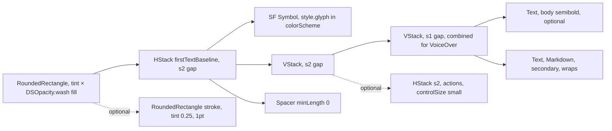

# CalloutBanner

**File:** [`apps/native/WolfWave/Views/Shared/CalloutBanner.swift`](../../apps/native/WolfWave/Views/Shared/CalloutBanner.swift)

## Purpose
Inline tinted callout that flags a state (info / success / warning / error / neutral) inside a settings pane. One component for every "icon + text in a tinted rounded box" pattern, so tint, icon, and corner radius all resolve from a single place. Supersedes the old `WarningBanner`, which only covered orange/red warnings and led call sites to hand-roll info/success variants with drifting radii and tint opacities. Also absorbs the former DEBUG-only `ConfigRequiredBanner`: use `CalloutBanner(message, style: .warning)` inside a `#if DEBUG` guard for "set X in Config.xcconfig" developer prompts.

## API
```swift
CalloutBanner("Updates are managed by Homebrew.", style: .info)
CalloutBanner("Viewers type **!sr song name**.", title: "How it works", style: .info)
CalloutBanner("Auto-updates on. We'll notify you of new versions.", style: .success)
CalloutBanner("Deleting the queue cannot be undone.", style: .error)
CalloutBanner("These tools mutate live state. Use at your own risk.", strokeVisible: true) // .warning default
CalloutBanner("The connection is off.", title: "Stream Deck", style: .warning) {
    Button("Open Stream Widgets", action: openStreamWidgets)
        .buttonStyle(.borderedProminent)
}
```

| Param | Type | Default | Notes |
|---|---|---|---|
| `message` | `String` | (required) | First positional arg. Parsed as **Markdown** so inline `**bold**` renders. Wraps via `.fixedSize(vertical: true)`. |
| `title` | `String?` | `nil` | Optional bold lead line above the body (e.g. "How it works"). |
| `style` | `Style` | `.warning` | `.info` / `.success` / `.warning` / `.error` / `.neutral`. Drives the tint and default icon. |
| `systemImage` | `String?` | `nil` | Overrides the style's default SF Symbol (e.g. `"hammer.fill"`). |
| `strokeVisible` | `Bool` | `false` | Overlays a 1pt stroke at 25% tint. Reserved for high-attention areas (Debug tab). |
| `actions` | `@ViewBuilder () -> some View` | none | Trailing builder (second init). The buttons that fix or act on the callout, drawn **inside** the box under the message, on its text column, in an `HStack` at `.small` control size. Callers pick each button's style; use `.borderedProminent` for the one obvious fix. Stored type-erased so `CalloutBanner` stays non-generic and `CalloutBanner.Style` keeps working. |

### Style maps to tint plus icon

| Style | Tint (wash, stroke, dark-mode icon) | Light-mode icon | Default icon |
|---|---|---|---|
| `.info` | `DSColor.info` | `DSColor.glyphInfoLight` | `info.circle.fill` |
| `.success` | `DSColor.success` | `DSColor.glyphSuccessLight` | `checkmark.circle.fill` |
| `.warning` | `DSColor.warning` | `DSColor.glyphWarningLight` | `exclamationmark.triangle.fill` |
| `.error` | `DSColor.error` | `DSColor.glyphErrorLight` | `exclamationmark.octagon.fill` |
| `.neutral` | `DSColor.neutral` | `DSColor.glyphNeutralLight` | `info.circle.fill` |

`Style.glyph(in:)` resolves the icon color through `DSColor.glyph(for:in:)`. The bright
tints read at about 2:1 on their own wash in light appearance, under the 3:1 floor for
meaningful non-text marks (WCAG 1.4.11); the glyph tokens reach 4.2:1 or better. See
[status-chip.md](status-chip.md#glyph-contrast) for the full table.

## Tokens used
- `DSFont.Size.body` (13): message with no title, and the title line
- `DSFont.Size.sm` (11): message when a `title` is present
- `DSSpace.s1` (4): title/message gap
- `DSSpace.s2` (8): icon/text gap, text-to-actions gap, gap between action buttons
- `DSSpace.s3` (10): vertical padding (was `s2` until 2026-10-26; an action row needs the extra air)
- `DSSpace.s4` (12): horizontal padding
- `AppConstants.SettingsUI.cardCornerRadius` (14): clip and stroke shape
- `DSOpacity.wash` (0.10): background fill
- `DSColor.info` / `.success` / `.warning` / `.error` / `.neutral`: semantic tints
- `DSColor.glyph…Light` (`glyphInfoLight`, `glyphSuccessLight`, `glyphWarningLight`, `glyphErrorLight`, `glyphNeutralLight`): icon color in light appearance

## Anatomy


## Accessibility
- Without actions, `.accessibilityElement(children: .combine)` collapses icon, title, and message into one VoiceOver element; the rendered (de-marked) text is read, so Markdown asterisks are not spoken.
- With actions, the box is `.contain`: title and message stay one combined element and each button stays separately focusable and pressable.
- The icon sits on the first text baseline, so it lines up with the title (or the message) instead of floating at the top of the text frame.
- The icon is `.accessibilityHidden`. Tint is decorative; the copy always carries the meaning.
- Icon contrast: in light appearance the icon uses the darker `glyph…Light` token so it stays above 3:1 on the wash. The message is `.secondary`, never `.tertiary`.
- Dynamic Type: the message uses `.fixedSize(horizontal: false, vertical: true)` so it wraps cleanly.

## Do / Don't
- ✅ Pick the `style` that matches the meaning: `.info` for tips, `.warning` for caution, `.error` for destructive, `.success` for confirmation, `.neutral` for a muted note.
- ✅ Use `title:` for a short bold lead line; keep the body to one idea.
- ✅ Reach for `CalloutBanner` before drawing your own tinted callout chrome.
- ✅ Put the button that fixes the callout in its `actions` slot. It sits inside the box on the text column (see `MusicPermissionBanner`, the Stream Deck "connection is off" callout).
- ❌ Don't render a fix button as a loose sibling under the banner. It floats on its own left edge and gap and reads as unrelated (the rule was reversed on 2026-10-26).
- ❌ Don't use it when no tint or background is needed. Use `HintRow` for a plain footnote tip.
- ❌ Don't set `strokeVisible: true` for routine callouts. Reserve the stroke for high-attention surfaces.

## Example
```swift
CalloutBanner(
    "WolfWave can't read the currently playing track. Enable Apple Music automation in System Settings.",
    style: .warning
)
```
