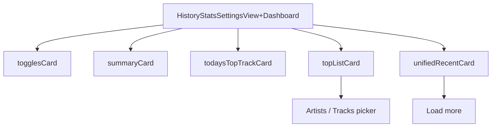

# HistoryStatsSettingsView+Dashboard

**File:** [`apps/native/WolfWave/Views/HistoryStats/HistoryStatsSettingsView+Dashboard.swift`](../../apps/native/WolfWave/Views/HistoryStats/HistoryStatsSettingsView+Dashboard.swift)

## Purpose

The dashboard half of [`HistoryStatsSettingsView`](history-stats-settings-view.md), split into its own file so the pane stays under the SwiftLint size limits. It is an extension of the pane, not a standalone component: the tracking toggles, the summary card, today's top track, the top artists / tracks leaderboard, and the recent plays list all read the pane's own state.

## API

```swift
extension HistoryStatsSettingsView {
    var togglesCard: some View
    var summaryCard: some View
    var todaysTopTrackCard: some View
    var topListCard: some View
    var unifiedRecentCard: some View
}
```

| Member | Notes |
|---|---|
| `togglesCard` | Listening History + Stats switches. |
| `summaryCard` | This week, Today, and All time play counts as `StatTile`s. |
| `todaysTopTrackCard` | Today's most-played track. |
| `topListCard` | Artists / Tracks leaderboard behind a segmented picker. |
| `unifiedRecentCard` | Recent plays with a Load more button. |

Only the pane's `unifiedLayout` composes these; nothing outside the pane should.

## Tokens used

- `DSFont.Size.sm`, `.base`, `.body`, `.lg`, `.xl`, `.x2xl` for row text and the top-track headline.
- `DSSpace.s0` through `.s6` for card and row spacing.
- `DSDimension.HistoryStats.topTrackMinHeight`, `.topListMinHeight`, and `.recentCardMinHeight` hold each card's footprint while data loads.

## Anatomy



## Accessibility

- The leaderboard picker carries the `topListPicker` identifier; Load more carries `loadMoreHistoryButton`.
- Cards keep a minimum height while loading so focus targets don't jump when data arrives.

## Do / Don't

- ✅ Keep new dashboard cards here and let `unifiedLayout` place them.
- ❌ Don't add stored properties here; Swift extensions can't hold them, so pane state stays in `HistoryStatsSettingsView.swift`.

## Example

```swift
// Inside HistoryStatsSettingsView.unifiedLayout
ResponsiveRow {
    summaryCard
} right: {
    todaysTopTrackCard
}
.skeleton(isLoadingHistory)
```
