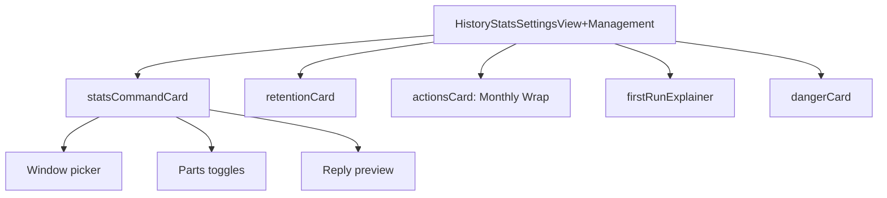

# HistoryStatsSettingsView+Management

**File:** [`apps/native/WolfWave/Views/HistoryStats/HistoryStatsSettingsView+Management.swift`](../../apps/native/WolfWave/Views/HistoryStats/HistoryStatsSettingsView+Management.swift)

## Purpose

The settings half of [`HistoryStatsSettingsView`](history-stats-settings-view.md), split into its own file so the pane stays under the SwiftLint size limits. It is an extension of the pane, not a standalone component: the `!stats` command card, retention, the Monthly Wrap action, the first-run explainer, the danger zone, and the handlers that keep Stats dependent on History.

## API

```swift
extension HistoryStatsSettingsView {
    var statsCommandCard: some View
    var retentionCard: some View
    var actionsCard: some View
    var firstRunExplainer: some View
    var dangerCard: some View
    func handleHistoryChange(_ enabled: Bool)
    func handleStatsChange(_ enabled: Bool)
}
```

| Member | Notes |
|---|---|
| `statsCommandCard` | `!stats` toggle, cooldowns, aliases, window, parts, and a live reply preview, gated on Twitch readiness. |
| `retentionCard` | How long plays are kept; shortening it confirms first. |
| `actionsCard` | Opens the Monthly Wrap sheet. |
| `firstRunExplainer` | Shown while History is off, with a Turn on button. |
| `dangerCard` | Clears all history behind a confirmation. |
| `handleHistoryChange` / `handleStatsChange` | Turning History off also turns Stats off. |

## Tokens used

- `DSFont.Size.xs`, `.body`, `.md` for helper text and card copy.
- `DSSpace.s1` through `.s6` for row and card spacing.
- `DSColor.error` for the danger zone.

## Anatomy



## Accessibility

- Controls carry stable identifiers: `statsCommandWindow`, `statsPart.<part>`, `statsCommandPreview`, `historyRetentionDays`, `turnOnHistoryButton`, and `statsOpenTwitchSettingsButton`.
- The parts toggles refuse to turn off the last part and say "Keep at least one." instead.
- Clearing history goes through `DestructiveButton` and a confirmation alert.

## Do / Don't

- ✅ Keep History as the parent capability: route toggle changes through `handleHistoryChange` / `handleStatsChange`.
- ❌ Don't add stored properties here; Swift extensions can't hold them, so pane state stays in `HistoryStatsSettingsView.swift`.

## Example

```swift
// Inside HistoryStatsSettingsView.unifiedLayout
if historyEnabled, statsEnabled {
    statsCommandCard
        .deepLinkSection("stats-command")
}
```
