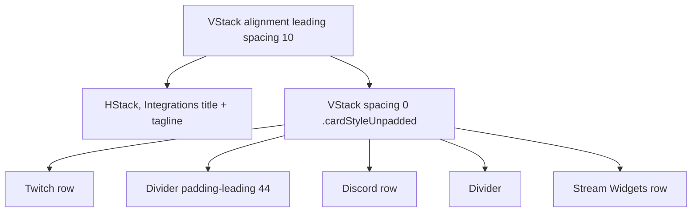
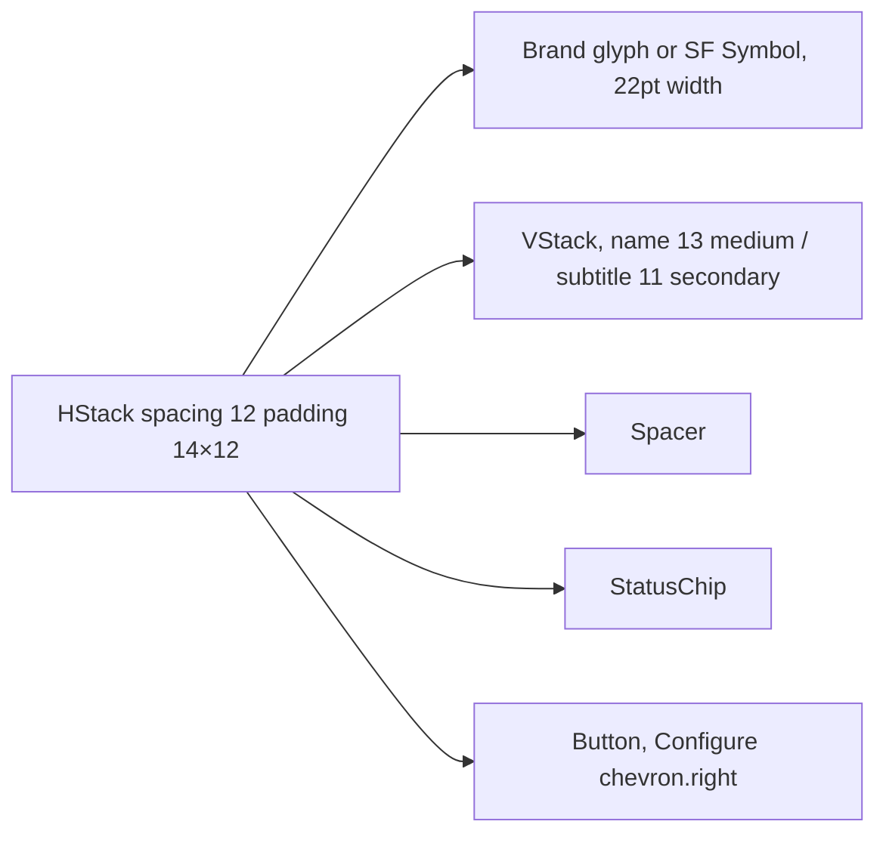

# IntegrationDashboardView

**File:** [`apps/native/WolfWave/Views/Shared/IntegrationDashboardView.swift`](../../apps/native/WolfWave/Views/Shared/IntegrationDashboardView.swift)

## Purpose
Connection dashboard on the General pane. One row per integration (Twitch chat, Discord profile, Stream Widgets) with brand glyph, plain-language status subtitle, `StatusChip`, and a "Configure ›" route into the relevant settings pane. Below the row-width token, the status and action move beneath the description so compact windows retain readable labels.

The rows report **connections, not what an audience sees**. A connected Discord session does not mean a song is showing, and a running widget server does not mean OBS loaded the browser source. Chip and subtitle copy must stay inside that limit.

## API
```swift
IntegrationDashboardView(
    twitchConnected: true,
    twitchChannel: "nightowlstream",
    discordEnabled: true,
    discordState: .connected,
    serverState: .listening,
    widgetURL: "http://localhost:8766",
    configure: { section in /* route */ }
)
```

| Param | Type | Notes |
|---|---|---|
| `twitchConnected` | `Bool` | Connected / Disconnected. |
| `twitchChannel` | `String?` | Rendered as `@channel` when connected; masked under Streamer Mode. |
| `discordEnabled` | `Bool` | The "Show on Discord" switch. Off outranks `discordState`. |
| `discordState` | `DiscordRPCService.ConnectionState` | Connected / Connecting / Disconnected. |
| `serverState` | `WebSocketServerService.ServerState` | Running / Starting / Couldn't start / Off. |
| `widgetURL` | `String` | Shown in the subtitle only while the server is listening; masked under Streamer Mode. Pass `WidgetLink.loopback` so a custom WebSocket port is included. |
| `permissionPaused` | `Bool` | Overrides every chip with `"Paused"` when Music permission is missing. |
| `configure` | `(Section) -> Void` | Routes to `.twitch / .discord / .obs`. |

### Status resolution

`IntegrationDashboardView.Status` is a pure, `nonisolated` value (chip text, tint, glyph, subtitle) with one static resolver per row: `twitch(...)`, `discord(...)`, `widget(...)`. Each reports the first thing in the user's way: Music permission, then the switch, then the connection. Add or change a state there, not in the view body, and pin it in `IntegrationDashboardViewTests`.

| Row | State | Chip | Tint |
|---|---|---|---|
| any | Music permission denied | Paused | `warning` |
| Twitch | connected / not | Connected / Disconnected | `success` / `neutral` |
| Discord | switch off | Off | `neutral` |
| Discord | connected / connecting / disconnected | Connected / Connecting / Disconnected | `success` / `warning` / `neutral` |
| Stream Widgets | listening / starting / error / stopped | Running / Starting / Couldn't start / Off | `success` / `warning` / `error` / `neutral` |

## Tokens used
- `DSColor.partnerTwitch` (`#9146FF`) / `DSColor.partnerDiscord` (`#5865F2`): brand glyph tints (via `AppConstants.Brand`)
- `DSColor.success` (`#34C759`): Connected / Running
- `DSColor.warning` (`#FF9F0A`): Paused / Connecting / Starting
- `DSColor.error`: Couldn't start
- `DSColor.neutral`: Off / Disconnected
- `DSFont.Size.base` (13) `.medium`: row name
- `DSFont.Size.sm` (11) `.secondary`: wrapping row subtitle
- `DSDimension.Settings.inlineActionsMinWidth` (480): minimum width for inline status and action; `ViewThatFits` stacks them below at narrower widths
- `DSFont.Size.body` (12): "Configure" button + section subhead
- `.sectionHeader()` (17 semibold, `.isHeader`): text-only "Integrations" header (no leading icon; see [section-header-with-status.md](section-header-with-status.md) for the no-icon-on-headers rule)
- `DSSpace.s5` (14): row horizontal padding
- `DSSpace.s4` (12): row vertical padding
- `DSDimension.Settings.cardCornerRadius` (14) via `.cardStyleUnpadded()`
- Composes `StatusChip`. See [status-chip.md](status-chip.md)

## Anatomy


Each row:


## Accessibility
- Each "Configure" button has explicit `accessibilityLabel("Configure <name>")`; VoiceOver reads the target integration.
- Each chip carries a `StatusChip.StateGlyph`, so state reads through shape as well as color.
- The host animates state changes through `withMotionSafeAnimation`, so Reduce Motion is honored.
- Brand-asset existence is cached (`brandIconExistsCache`) so asset-catalog lookups happen once per icon.

## Do / Don't
- ✅ Place once on the General tab below `NowPlayingHeroCard`.
- ✅ Always pass `permissionPaused`; without it, chips show "Connected" while audio tracking is actually frozen.
- ✅ Pass the services' lifecycle enums whole. Collapsing them to a Bool hides Connecting, Starting, and a failed server.
- ❌ Don't write copy that claims what viewers see ("Live", "Showing now", "Ready for OBS"). The app can't observe it.
- ❌ Don't reuse the dashboard as an integration settings pane; put its status beside that pane's relevant controls.
- ❌ Don't duplicate rows; the three broadcast surfaces are fixed. New integrations need their own row + chip wiring.

## Example
```swift
IntegrationDashboardView(
    twitchConnected: twitchConnected,
    twitchChannel: twitchChannel,
    discordEnabled: discordPresenceEnabled,
    discordState: discordState,
    serverState: serverState,
    widgetURL: WidgetLink.loopback,
    permissionPaused: permissionState == .denied,
    configure: configure
)
```
