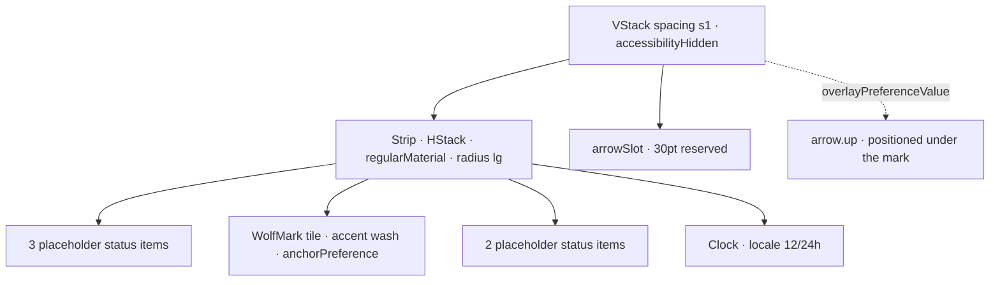

# MenuBarPointer

**File:** [`apps/native/WolfWave/Views/Onboarding/Components/MenuBarPointer.swift`](../../apps/native/WolfWave/Views/Onboarding/Components/MenuBarPointer.swift)

## Purpose

A drawn menu-bar strip with the WolfWave mark highlighted and an arrow bobbing up at it,
so a new user knows where the app lives once setup closes.

It sits on the onboarding completion screen. It used to be the wizard's own last step,
which **Skip setup** jumped straight past; on the completion screen every ending shows it.
The strip is a drawing, not a capture of the real menu bar, so the mark's position is
illustrative.

## API

```swift
MenuBarPointer()
```

No parameters. Reads `accessibilityReduceMotion` from the environment.

## Tokens used

- `DSSpace.s1` (4) strip-to-arrow spacing, clock leading padding
- `DSSpace.s2` (8) status-item spacing and vertical padding
- `DSSpace.s5` (14) horizontal padding
- `DSRadius.sm` (6) highlighted mark tile
- `DSRadius.lg` (10) strip corners
- `DSFont.Size.body` (12) clock
- `DSFont.Size.x2xl` (22) arrow glyph
- `DSDimension.Onboarding.contentMaxWidth` (440) strip width cap
- `DSMotion.Duration.pulse` / `pulseSlow` for the arrow bob and the mark glow

## Anatomy



## Accessibility

- The whole view is `accessibilityHidden`. It is decoration for text that already says
  where WolfWave lives, so VoiceOver reads the completion screen's summary instead.
- **Reduce Motion:** neither repeating animation starts; the arrow and mark stay still.
- The clock follows the user's 12- or 24-hour setting.

## Do / Don't

- ✅ Pair it with a line of text that says the same thing ("Click the wolf in your menu bar").
- ✅ Keep it on a screen every path reaches, so nobody skips past it.
- ❌ Don't make it a step of its own again. Skip setup would jump over it.
- ❌ Don't add interactivity. It points at the real menu bar; it isn't one.

## Example

```swift
VStack(spacing: DSSpace.s7) {
    Text("WolfWave lives in your menu bar.")
    MenuBarPointer()
        .padding(.horizontal, DSSpace.s10)
}
```
