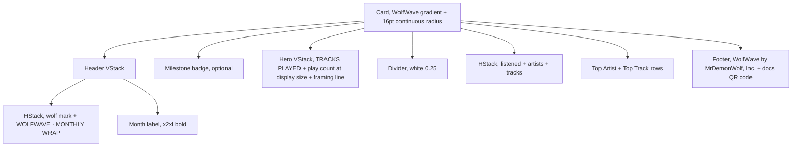

# MonthlyWrapCard

**File:** [`apps/native/WolfWave/Views/HistoryStats/MonthlyWrapView.swift`](../../apps/native/WolfWave/Views/HistoryStats/MonthlyWrapView.swift)

## Purpose
Shareable "wrapped"-style summary card for a single calendar month: wordmark + wolf mark lockup, headline stats (plays, listening time, top artist, top track), and an attribution footer. Rendered both in the sheet UI and exported to PNG via `ImageRenderer(scale: 2)`.

## API
```swift
MonthlyWrapCard(data: wrap)
    .frame(width: 380)
```

| Param | Type | Notes |
|---|---|---|
| `data` | `MonthlyWrapData` | Aggregated month summary. When `data.hasData == false` the card renders the empty state. |
| `hasAnyHistory` | `Bool` | Defaults to `true`. `false` means no plays have ever been recorded, so the empty state is the "Nothing to wrap yet." prompt instead of the per-month "No plays recorded" line. |
| `tint` | `Color?` | Defaults to `nil`. A color sampled from the top track's album art, blended as a corner accent over the gradient. `nil` shows the plain gradient. |

Card width is owner-controlled (production callers use `380`). Height grows to content.

The hosting Monthly Wrap sheet shows a warning callout for rendering or file-write failures. Share exports use unique temporary PNG files, removed when sharing completes or is cancelled.

## Tokens used
- Background gradient: `AppConstants.Brand.wolfwaveGradientStart` → `wolfwaveGradientEnd` (`DSColor.partnerWolfwaveGradientStart` / `End`, `#0A2540` → `#2563EB`)
- Type: `DSFont.Size.xs` (eyebrows, milestone badge, row captions, footer), `DSFont.Size.sm` (mini-stat label), `DSFont.Size.base` (framing line, empty states), `DSFont.Size.md` (top artist / track value), `DSFont.Size.lg` (mini-stat value, empty-state heading), `DSFont.Size.x2xl` (month label), `DSFont.Size.display` (52, the hero play count). This is the one surface that uses the `display` rung; it renders to an exported image, not settings chrome.
- Spacing: `DSSpace.s0` (lockup), `DSSpace.s1` (hero stack, milestone badge), `DSSpace.s2` (mark gap, footer top, empty-state stack), `DSSpace.s3` (badge horizontal pad), `DSSpace.s4` (empty state vertical pad), `DSSpace.s5` (outer stack), `DSSpace.s7` (card padding, mini-stat row)
- Wolf mark dimension: `DSSpace.s6` (16): canonical `WolfMark` rendered as `.template` over white
- QR code dimension: `DSDimension.Onboarding.brandTileSize`, encoding `AppConstants.URLs.docs`
- Foreground: pure white at `1.0` (primary), `0.7` (eyebrow + mini-stat label), `0.6` (row caption), `0.55` (footer), `0.25` (divider)
- Corner radius: `DSRadius.x2xl` (16, continuous)

## Anatomy


When `!data.hasData`, the Milestone / Hero / Rule / Stats / Rows nodes collapse to one message: `"No plays recorded in <month>."`, or the `"Nothing to wrap yet."` prompt when `hasAnyHistory` is `false`.

## Accessibility
- Decorative-only graphic; text content carries every datum (counts, top artist, top track) so a screen reader synthesizing the card by reading children gets the full summary.
- Foreground/background contrast: white text on `#0A2540` start stop measures ≥ 12:1 (AAA). At the brightest `#2563EB` end stop it measures ≥ 4.7:1 (AA Large for the `x2xl` month label and the `display` play count; AA Normal for the `lg` mini-stat values and the `sm` labels). Avoid lowering the gradient end stop's luminance; it's at the contrast floor for the smaller `xs` footer text already softened to `opacity 0.55`.
- Wolf mark rendered with `renderingMode(.template)`; inherits the white foreground. No color-only semantics.

## Do / Don't
- ✅ Pass a `MonthlyWrapData` produced by `MonthlyWrap.data(from:month:calendar:)`; the card relies on its `monthLabel`, `hasData`, and counter fields being internally consistent.
- ✅ Frame to `380` for share parity; that's the production size the PNG export ships at.
- ❌ Don't swap the gradient to a partner brand (Apple Music, Discord, Twitch); this card represents WolfWave, not the playback source.
- ❌ Don't hand-edit the generated token files to retune the gradient. Edit `design-system/tokens.json` and regenerate.
- ❌ Don't remove the attribution footer; re-shared screenshots rely on it for provenance.

## Example
```swift
let wrap = service.monthlyWrap(for: Date())
MonthlyWrapCard(data: wrap)
    .frame(width: 380)
```

Export path (see `MonthlyWrapView.exportImage()`):
```swift
let renderer = ImageRenderer(content:
    MonthlyWrapCard(data: wrap)
        .frame(width: 380)
        .padding(DSSpace.s7)
        .background(Color(nsColor: .windowBackgroundColor))
)
renderer.scale = 2
```
