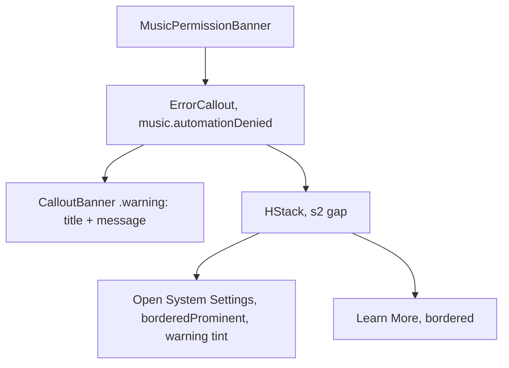

# MusicPermissionBanner

**File:** [`apps/native/WolfWave/Views/Shared/MusicPermissionBanner.swift`](../../apps/native/WolfWave/Views/Shared/MusicPermissionBanner.swift)

## Purpose
Warning callout shown when WolfWave is missing the Apple Music access it needs for a feature. A thin, purpose-named wrapper over [`ErrorCallout`](error-callout.md): it builds the `music.automationDenied` `UserFacingError` from the caller's copy and maps its actions to behavior. "Open System Settings" deep-links to the Automation pane via `MusicPermissionChecker.openAutomationSettings()`; "Learn More" opens the `#music-permission` section of the troubleshooting docs.

Currently covers **Apple Events automation** permission (used by `AppleMusicSource` for now-playing reads, listening history recording, etc.). The MusicKit `MusicAuthorization` flow used by Song Requests is rendered by `SongRequestMusicAuthCard` inside `SongRequestSettingsView`; migrating that to this banner is tracked as future cleanup.

## API
```swift
MusicPermissionBanner(
    message: "WolfWave needs Apple Music automation access to record what you play. Enable it in System Settings → Privacy & Security → Automation."
)
```

| Param | Type | Notes |
|---|---|---|
| `message` | `String` | User-facing explanation of what the missing permission blocks. Rendered as the body under the title "Let WolfWave read what's playing". Keep ADHD-friendly: short, punchy, jargon-free. |
| `onOpenSettings` | `@MainActor () -> Void` | Optional. Defaults to `MusicPermissionChecker.openAutomationSettings`. Override only for tests, previews, or the Debug gallery. |

`MusicPermissionBanner.error(message:)` is the pure, `nonisolated` builder for the rendered `UserFacingError` (id `music.automationDenied`, severity `.warning`, primary `.openAutomationSettings`, `docsAnchor` `music-permission`), unit-tested by `MusicPermissionBannerTests`.

The banner does **not** self-gate on permission state. Callers wrap it in `if state == .denied { ... }`. This keeps the component dumb and the caller in control of when to render.

## Tokens used
Inherited from [`ErrorCallout`](error-callout.md) and [`CalloutBanner`](callout-banner.md); this view adds no chrome of its own.
- Tint: `DSColor.warning` via `CalloutBanner.Style.warning` (severity `.warning`), on both the banner wash and the filled button
- `DSSpace.s4` (12): banner-to-button gap; `DSSpace.s2` (8): gap between buttons
- `DSFont.Size.body` (12) semibold title, `DSFont.Size.sm` (11) message
- `AppConstants.SettingsUI.cardCornerRadius` rounded corners

## Anatomy


## Accessibility
- `ErrorCallout` root is `.accessibilityElement(children: .contain)`, so both buttons stay reachable. VoiceOver reads `"Let WolfWave read what's playing. <message>"`.
- Icon is decorative (`accessibilityHidden(true)` in `CalloutBanner`).
- Identifiers for UI tests: `errorCallout.music.automationDenied` on the callout, `errorCallout.music.automationDenied.action.openAutomationSettings` on the primary button, and `errorCallout.music.automationDenied.action.openDocs.music-permission` on Learn More. (Replaces the old `musicPermissionOpenSettings`.)
- Color is **not the sole signal**; the triangle glyph, title, and message convey the warning independently.

## Do / Don't
- ✅ Render conditionally above the gated controls so the user can act before flipping a toggle that won't work.
- ✅ When using this banner, also disable the dependent toggles (e.g. `isDisabled: musicPermission == .denied`).
- ❌ Don't render unconditionally. A warning with no problem to solve is noise.
- ❌ Don't reuse for non-Apple-Music permissions; build a `UserFacingError` and use `ErrorCallout` directly.
- ❌ Don't wrap it in a second banner or add buttons beside it. The actions already travel with the error.

## Example
```swift
if musicPermission == .denied {
    MusicPermissionBanner(
        message: "WolfWave needs Apple Music automation access to record what you play. Enable it in System Settings → Privacy & Security → Automation."
    )
}
```
