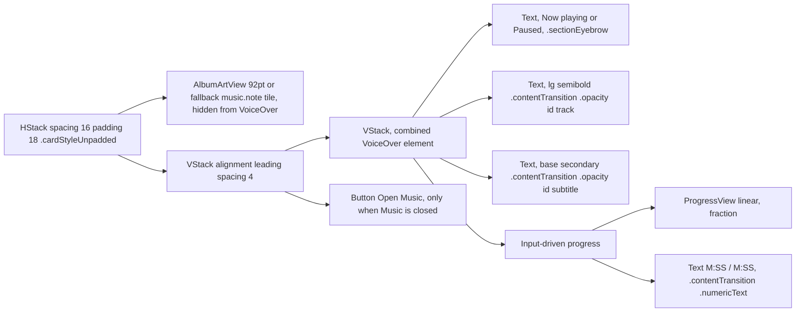

# NowPlayingHeroCard

**File:** [`apps/native/WolfWave/Views/Shared/NowPlayingHeroCard.swift`](../../apps/native/WolfWave/Views/Shared/NowPlayingHeroCard.swift)

## Purpose
The "Now Playing" hero on the Music Monitor pane: 92pt album art, title/artist/album, and a scrubber. Composes `AlbumArtView` for the artwork tile and the standard macOS card surface (`.cardStyleUnpadded()`) for the card background.

## API
```swift
NowPlayingHeroCard(
    track: "Moonlit Howl",
    artist: "Arctic Wolf",
    album: "Tundra Sessions",
    elapsed: 68,
    duration: 201
)
```

| Param | Type | Notes |
|---|---|---|
| `track` | `String?` | Nil renders the empty state. The headline comes from `emptyStateTitle(trackingEnabled:musicNotRunning:)`: "Sync Music is off" when tracking is off, "Apple Music isn't open" when Music is closed, otherwise "Nothing playing right now". |
| `artist` | `String?` | Combined with album into a single em-dash separated subtitle. |
| `album` | `String?` | Same; either, both, or neither can be nil. |
| `artwork` | `NSImage?` | When nil the inner `AlbumArtView` falls back to `artworkURL`, then to a hashed gradient. |
| `artworkURL` | `URL?` | Remote artwork source passed to `AlbumArtView(url:)`, used when `artwork` is nil. |
| `elapsed` | `TimeInterval` | Seconds. Shown as `M:SS` in monospaced caption. |
| `duration` | `TimeInterval` | Seconds. Scrubber + total time hidden when 0. |
| `trackingEnabled` | `Bool` | Drives the empty-state copy when `track == nil`. |
| `isPaused` | `Bool` | Paused affordance: dims and desaturates the artwork, overlays a pause glyph, freezes the scrubber, and changes the eyebrow to "Paused". Title and subtitle stay at full opacity. The VoiceOver label starts with "Paused:". |
| `musicNotRunning` | `Bool` | Music.app has no running process. With tracking on and `track == nil`, shows "Apple Music isn't open", a separate empty state from "nothing playing". |
| `onOpenMusic` | `(() -> Void)?` | Open Music button action. The button shows only when `track == nil`, tracking is on, and `musicNotRunning` is true. Leave it nil to hide the button. |

## Tokens used
- `DSDimension.Settings.cardCornerRadius` (14): card corner radius via `.cardStyleUnpadded()` (opaque `controlBackgroundColor` surface)
- `.sectionEyebrow()` (`DSFont.Size.sm` 11, semibold, `.secondary`, sentence case): "Now playing" / "Paused" eyebrow label
- `DSFont.Size.lg` (17) `.semibold`: track title, up to two lines in compact panes
- `DSFont.Size.base` (13) `.secondary`: artist · album subtitle, up to two lines
- `DSFont.Size.sm` (11) monospaced: scrubber timestamps
- `DSSpace.s7` (20): card outer padding
- `DSSpace.s6` (16): artwork ↔ text gap
- `DSMotion.Duration.base` (0.22): track-change and pause-state animation, via `.motionSafe(_:value:)` so it drops out under Reduce Motion
- `DSRadius.lg` (10): empty-state artwork placeholder corner
- Composes `AlbumArtView` (92pt); see [album-art-view.md](album-art-view.md)

## Motion

- **Title swap:** `id(track ?? "")` + `.contentTransition(.opacity)` so each unique title gets its own identity and cross-fades into the next.
- **Subtitle swap:** same `id(subtitle)` + `.contentTransition(.opacity)` pattern for `artist · album`.
- **Timecode:** `.contentTransition(.numericText())` on the `M:SS / M:SS` text. Digits tween instead of blink-replacing every second.
- **Scrubber:** `ProgressView(value:)` reads the supplied `elapsed` and `duration`. It updates when those inputs change, without a recurring timeline that redraws an unchanged value.
- **Outer animation:** `.motionSafe(.easeInOut(duration: DSMotion.Duration.base), value: track)` and the same modifier with `value: isPaused`, both on the card, so callers don't need to wrap track or pause changes in `withAnimation`. The `isPaused` one covers the pause glyph's insertion and removal, the artwork dim and desaturate, and the eyebrow swap.
- Track-change animations respect `accessibilityReduceMotion`; progress remains input-driven in either mode.

## Anatomy


## Accessibility
- `accessibilityElement(children: .combine)` is applied to the information group only (eyebrow, title, subtitle, scrubber). The artwork is hidden from VoiceOver because the compound label already says paused or playing.
- The `Open Music` button sits outside the combined group, so it stays its own VoiceOver and Voice Control target in the empty state.
- Compound label: `"Now playing: <track>, by <artist>, on <album>"`; falls back to permission-state copy when no track.
- When `duration > 0` the label appends the scrubber clock: `"…, <elapsed> elapsed, <remaining> remaining"` (formatted via `HistoryFormat.clock`), so VoiceOver announces playback position that the visual scrubber otherwise conveys only graphically.
- `monospacedDigit()` keeps timestamps stable as the seconds tick.
- Reduce Motion: track swaps are instant; scrubber updates still follow the supplied playback position.

## Do / Don't
- ✅ Place under the Music Monitor pane's "Live from Apple Music" eyebrow, single instance per pane.
- ✅ Pass nil `track` rather than empty strings so the empty state copy renders.
- ❌ Don't use elsewhere as a "song chip"; use a `Compact` widget layout or a custom row instead.
- ❌ Don't override the card padding/radius; they're tuned to the standard card surface.

## Example
```swift
NowPlayingHeroCard(
    track: currentTrack,
    artist: currentArtist,
    album: currentAlbum,
    artworkURL: currentArtworkURL,
    trackingEnabled: trackingEnabled,
    isPaused: currentIsPaused,
    musicNotRunning: currentTrack == nil && !MusicProcess.isRunning,
    onOpenMusic: { Task { await MusicPermissionChecker.ensureMusicRunning() } }
)
```
