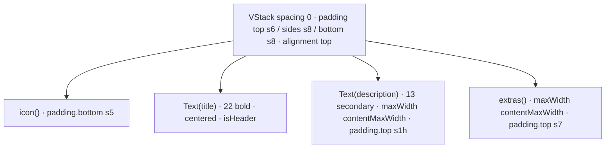

# OnboardingStepScaffold

**File:** [`apps/native/WolfWave/Views/Onboarding/Components/OnboardingStepScaffold.swift`](../../apps/native/WolfWave/Views/Onboarding/Components/OnboardingStepScaffold.swift)

## Purpose

Shared top-aligned layout for every interior onboarding step: icon, title, one-line
description, then the step's controls, all hung from the same top edge.

It used to center a fixed-height column with balanced spacers and a 220pt floor under the
controls. That kept the icon still, but it floated short steps in the middle of the window
with a big empty gap between the copy and the button, and a tall step (Notifications) still
pushed its header up. Top alignment gets the same stillness for free: nothing above the
controls depends on how tall they are, so the icon and title sit at an identical Y on every
step, and the controls start right under the copy.

## API

```swift
OnboardingStepScaffold(
    title: String,
    description: String,
    icon: () -> Icon,       // @ViewBuilder
    extras: () -> Extras    // @ViewBuilder
)
```

| Param | Type | Notes |
|---|---|---|
| `title` | `String` | H1 for the step. 22pt bold, centered, multiline, `.isHeader` for VoiceOver. |
| `description` | `String` | One short sentence. 13pt secondary, capped at `contentMaxWidth`. |
| `icon` | `@ViewBuilder () -> Icon` | Usually a [`BrandTile`](brand-tile.md). Any view works. |
| `extras` | `@ViewBuilder () -> Extras` | Step-specific controls, capped at `contentMaxWidth`. `EmptyView()` is fine. |

The old `isOptional` eyebrow is gone. Nearly every step was optional, so the label was noise;
the progress header ("Step 3 of 7 · Discord") and the primary button's **Skip** label now say
what matters.

Generic over `Icon: View` and `Extras: View`, so there is no `AnyView` erasure.

## Tokens used

- `DSSpace.s6` (16) top padding
- `DSSpace.s5` (14) icon-to-title gap
- `DSSpace.s1h` (6) title-to-description gap
- `DSSpace.s7` (20) description-to-controls gap
- `DSSpace.s8` (24) horizontal and bottom padding
- `DSFont.Size.x2xl` (22) `.bold` title
- `DSFont.Size.base` (13) description, `.secondary`
- `DSDimension.Onboarding.contentMaxWidth` (440) line-length cap for description and controls

## Anatomy



## Accessibility

- The title carries the `.isHeader` trait, so VoiceOver's heading rotor lands on each step.
- Both `Text` views use `.fixedSize(horizontal: false, vertical: true)`, so larger text wraps
  to more lines instead of truncating.
- The wizard wraps the step in a `ScrollView`, so a tall step scrolls instead of clipping.
- Order in the accessibility tree follows visual order: icon (decorative), title,
  description, controls.

## Do / Don't

- ✅ Use it for every interior onboarding step, so the header never moves between screens.
- ✅ Keep the description to one short sentence. The controls explain the rest.
- ✅ Let tall controls run down the window; the container scrolls.
- ❌ Don't center it vertically again. That's what floated the controls away from the copy.
- ❌ Don't add a second title or eyebrow above the title. The progress header names the step.
- ❌ Don't restyle the title at the call site. Welcome and Completion are the 26pt bookends.

## Example

```swift
OnboardingStepScaffold(
    title: "Show your music on Discord",
    description: "Friends see the song, artist, and cover art under your name.",
    icon: {
        BrandTile(
            background: AnyShapeStyle(AppConstants.Brand.discord),
            glowColor: AppConstants.Brand.discord,
            glyph: BrandTileGlyph.asset("DiscordLogo")
        )
    },
    extras: {
        ToggleSettingRow(
            title: "Show on Discord",
            subtitle: "Off. Turn it on any time.",
            isOn: $presenceEnabled,
            accessibilityLabel: "Show on Discord",
            accessibilityIdentifier: "onboardingDiscordToggle"
        )
    }
)
```
