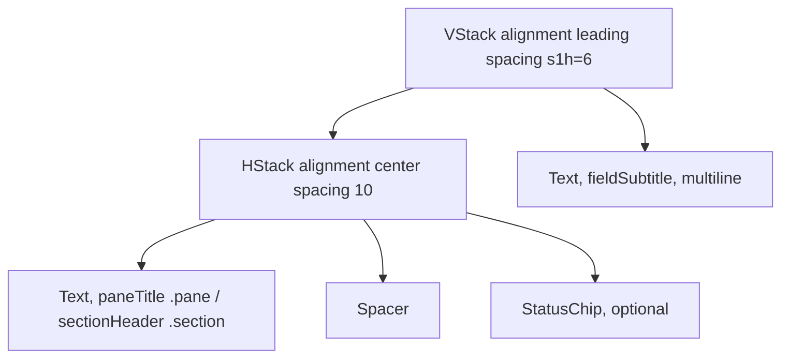

# SectionHeaderWithStatus

**File:** [`apps/native/WolfWave/Views/Shared/SectionHeaderWithStatus.swift`](../../apps/native/WolfWave/Views/Shared/SectionHeaderWithStatus.swift)

## Purpose
Section header (title + subtitle) with an optional inline `StatusChip` on the trailing edge. Used for sections inside settings panes, such as Discord Preview and Widget Appearance. The native window toolbar supplies the selected pane title; do not repeat it in the content. Renders at one of two heading levels via `prominence`.

## API
```swift
SectionHeaderWithStatus(
    title: "Preview",
    subtitle: "How your profile will look on Discord.",
    prominence: .section,     // section heading inside a settings pane
    statusText: "Connected",
    statusColor: DSColor.success
)
```

| Param | Type | Notes |
|---|---|---|
| `title` | `String` | Short noun-phrase. Rendered via `.paneTitle()` (22 bold) when `prominence == .pane`, `.sectionHeader()` (17 semibold) when `.section`. |
| `subtitle` | `String` | One-sentence purpose. Rendered via `.fieldSubtitle()` (13 secondary). Wraps vertically. |
| `prominence` | `Prominence` | `.pane` (default) is available for standalone content titles; use `.section` for sections inside Settings. The window toolbar already supplies the pane title. |
| `statusText` | `String?` | Drives the trailing chip. Nil → no chip rendered. |
| `statusColor` | `Color?` | Required when `statusText` is non-nil. Use a semantic token (`DSColor.success` / `.warning` / `.error` / `.info` / `.neutral`), never a raw system color. See the state tint vocabulary in [status-chip.md](status-chip.md). |
| `statusSymbol` | `String?` | Optional leading SF Symbol for the chip, passed straight through to `StatusChip(systemImage:)` so state isn't conveyed by color alone. Use a `StatusChip.StateGlyph.*` value. Applies to the **chip**, not the header title (headers stay text-only; see Do / Don't). |

## Tokens used
- `.paneTitle()` (22 bold) / `.sectionHeader()` (17 semibold) view modifiers (defined in `ViewModifiers.swift`): title typography by `prominence`. Both carry the `.isHeader` accessibility trait.
- `.fieldSubtitle()` (`DSFont.Size.base` 13, `.secondary`): subtitle
- `DSSpace.s1h` (6): title ↔ subtitle vertical spacing
- `DSSpace.s3` (10): title ↔ chip horizontal spacing
- Composes `StatusChip`. See [status-chip.md](status-chip.md)

## Anatomy


## Accessibility
- `accessibilityElement(children: .combine)` so VoiceOver speaks the header as a single unit. The title modifier's `.isHeader` trait merges into the combined element, so the VoiceOver heading rotor lands on every pane/section title.
- Chip's own label is overridden to `"<title> status: <statusText>"` so context is preserved.
- Pass `statusSymbol` so the chip's state reads through shape as well as color (WCAG 1.4.1); the symbol is decorative (hidden from VoiceOver) and the text still carries the status.
- The chip owns its own reduce-motion-aware state animation (`StatusChip` gates `value: text` / `value: color` on `accessibilityReduceMotion`). The previously-redundant outer `.animation(value: statusText)` on the chip was dropped 2026-06-06 so motion is gated in exactly one place.

## Do / Don't
- ✅ Use `.section` for headings inside Settings and let the toolbar name the pane.
- ✅ Put connection status next to the control it describes; omit the chip when no status applies.
- ❌ Don't repeat the toolbar title in the content or treat static metadata as a live status.
- ❌ Don't put body content inside the header. Render it separately below.
- ❌ **No leading SF Symbol icon on a pane or section header.** Headers (`.paneTitle()` / `.sectionHeader()`) stay text-only; that is the macOS Settings convention (icons live in the sidebar, not on inline headers) and keeps the panes flat and consistent. Six former sub-headers (Integrations, Bot Commands, Widget Setup, Widget Appearance, Chat Vote-Skip, Song Request Commands) once carried a blue `.controlAccentColor` glyph; they were removed 2026-06-04. The gray card-eyebrow (`CardEyebrowHeader`, History & Stats) and the red Danger Zone warning are a separate, semantic tier and may keep their icon.

> **Type ramp note.** The retired `.sectionSubHeader()` (15pt, only 2pt under the old 17pt pane title) was removed 2026-06-05. The ramp is now `.paneTitle()` 22 → `.sectionHeader()` 17 → `.sectionEyebrow()` 11, with perceptible steps per NN/g visual-hierarchy guidance. Former `.sectionSubHeader()` call sites are now `.sectionHeader()` (section titles) or `.sectionEyebrow()` (small card labels).

## Example
```swift
SectionHeaderWithStatus(
    title: "Preview",
    subtitle: "How your profile will look on Discord.",
    prominence: .section,
    statusText: viewModel.isConnected ? "Connected" : nil,
    statusColor: viewModel.isConnected ? DSColor.success : nil,
    statusSymbol: viewModel.isConnected ? StatusChip.StateGlyph.on : nil
)
```
