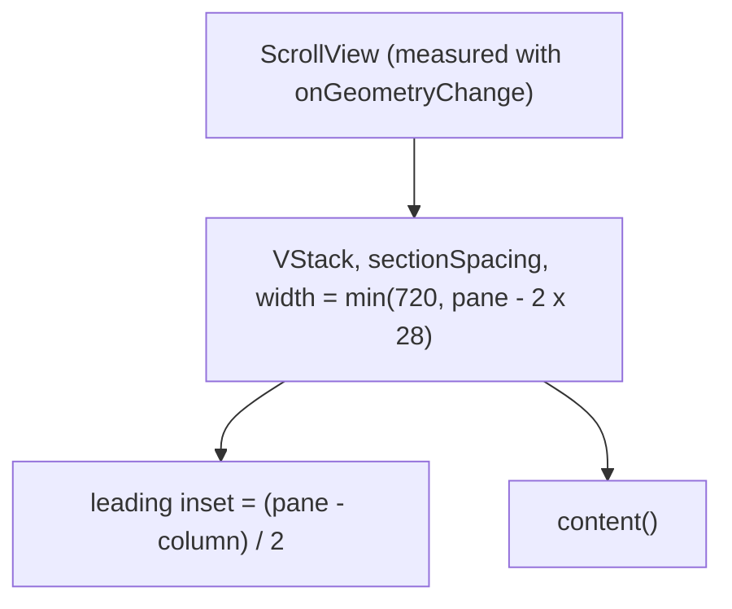

# SettingsPaneScroll

**File:** [`apps/native/WolfWave/Views/Shared/SettingsPaneScroll.swift`](../../apps/native/WolfWave/Views/Shared/SettingsPaneScroll.swift)

## Purpose
The scrolling content column every settings pane without a jump rail sits in: the `SettingsView` shared pane wrapper (Twitch, Discord, Stream Widgets, Stream Deck, Software Update, Advanced, About), General, and Song Requests. It clamps the column to the 720-point maximum, centers it, and applies the standard insets.

The column is centered on the **scroll view's own width**, scroller included. With legacy (always-visible) scroll bars, a pane that overflows loses the scroller gutter from its content width and a short pane does not, so centering inside the content put a short pane a few points right of every long one. Measuring the outer frame puts every pane's column at the same x; the right-hand inset absorbs the gutter.

## API
```swift
SettingsPaneScroll {
    SectionHeaderWithStatus(title: "Software Update", subtitle: "…")
    softwareUpdateCard
}
```

| Param | Type | Notes |
|---|---|---|
| `content` | `@ViewBuilder () -> Content` | The pane's sections, stacked with `SettingsUI.sectionSpacing`. |

## Tokens used
- `AppConstants.SettingsUI.maxContentWidth` (`DSDimension.Settings.maxContentWidth`, 720): column cap
- `AppConstants.SettingsUI.contentPaddingH` (28) / `contentPaddingV` (22): pane insets
- `AppConstants.SettingsUI.sectionSpacing` (24): gap between sections

## Anatomy


## Accessibility
- Adds no elements of its own; VoiceOver reads the pane's sections in order.
- Keeps the native `ScrollView`, so scrolling, the scroll bar, and the `ScrollViewReader` deep-link jumps in `SettingsView` behave as before.

## Do / Don't
- ✅ Use it for any new settings pane that has no jump rail.
- ✅ Let it own the insets; pass only the pane's sections.
- ❌ Don't wrap a pane in a hand-rolled `ScrollView` with `.frame(maxWidth: .infinity, alignment: .center)`; its column shifts with the scroll-bar gutter.
- ❌ Don't use it for panes with a jump rail; those use [`SettingsNavRail`](settings-nav-rail.md).

## Example
```swift
var body: some View {
    SettingsPaneScroll {
        header
        MusicMonitorSettingsView(configure: configure)
            .deepLinkSection("music")
        NotificationsSettingsView()
            .deepLinkSection("notifications")
    }
}
```
