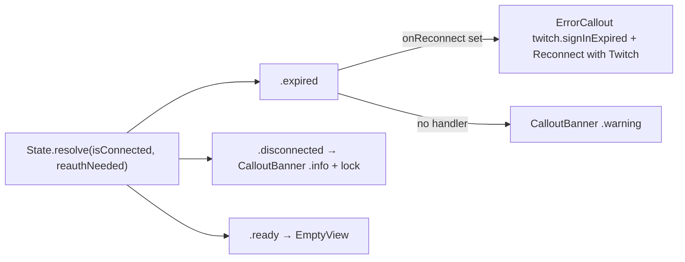

# TwitchConnectionNotice

**File:** [`apps/native/WolfWave/Views/Shared/TwitchConnectionNotice.swift`](../../apps/native/WolfWave/Views/Shared/TwitchConnectionNotice.swift)

## Purpose
Inline gate banner shown when a pane's feature depends on a live Twitch connection. It maps the two Twitch auth flags `(isConnected, reauthNeeded)` to one of three outcomes: an **expired** sign-in renders an orange `.warning` `CalloutBanner`, a never-**disconnected** state renders a blue `.info` banner with a lock glyph, and a connected-and-valid state renders nothing. Centralizes the style/icon/copy split that the Twitch pane's Bot Commands card and the Song Requests pane each hand-rolled (and that had drifted: Song Requests showed the calm "connect" info note even when the sign-in had actually expired).

An expired sign-in is an error the user can fix, so when the caller passes `onReconnect` it renders as an [`ErrorCallout`](error-callout.md) (`twitch.signInExpired`, title "Twitch sign-in expired", one "Reconnect with Twitch" button). Without a handler there is nothing to press, so it stays a plain [`CalloutBanner`](callout-banner.md) note. Every shipping call site (Twitch Bot Commands, Custom Commands, Song Requests, and the History & Stats `!stats` card) passes `SettingsView.reconnectTwitch`, which jumps to the Twitch pane's account card (where the device code renders) and starts the sign-in. The disconnected state is guidance, not an error, and is always a `CalloutBanner`.

## API
```swift
TwitchConnectionNotice(
    isConnected: viewModel.channelConnected,
    reauthNeeded: viewModel.reauthNeeded,
    expiredMessage: "Chat commands are paused until you reconnect.",
    disconnectedMessage: "Connect with Twitch above to let people use these chat commands.",
    onReconnect: reconnectTwitch
)
```

| Param | Type | Default | Notes |
|---|---|---|---|
| `isConnected` | `Bool` | (required) | Whether Twitch chat is currently connected. |
| `reauthNeeded` | `Bool` | (required) | Whether the stored token expired. Wins over `isConnected` (expired → warning). |
| `expiredMessage` | `String` | (required) | Copy for the orange warning. Keep it feature-specific ("…song requests" vs "…chat commands"). |
| `disconnectedMessage` | `String` | (required) | Copy for the blue info + lock note. |
| `onReconnect` | `(@MainActor () -> Void)?` | `nil` | Starts the Twitch reconnect. When set, the expired state becomes an `ErrorCallout` with a "Reconnect with Twitch" button. The title already says the sign-in expired, so word `expiredMessage` as what stopped working. |

### State resolution

| `reauthNeeded` | `isConnected` | `State` | Rendered |
|---|---|---|---|
| `true` | any | `.expired` | `onReconnect` set: `ErrorCallout(error: expiredError(message: expiredMessage))`. Otherwise `CalloutBanner(expiredMessage, style: .warning)` |
| `false` | `false` | `.disconnected` | `CalloutBanner(disconnectedMessage, style: .info, systemImage: "lock.fill")` |
| `false` | `true` | `.ready` | `EmptyView` |

`State.resolve(isConnected:reauthNeeded:)` and `expiredError(message:)` are pure, `nonisolated` static functions, unit-tested by `TwitchConnectionNoticeTests` (which also checks that a reconnect handler adds the action row).

## Tokens used
Inherited entirely from [`CalloutBanner`](callout-banner.md) and, for the actionable expired state, [`ErrorCallout`](error-callout.md): `DSColor.warning` / `.info`, `DSFont.Size.body` / `.sm`, `DSSpace.s1` / `s2` / `s3` / `s4`, `AppConstants.SettingsUI.cardCornerRadius`. This view adds no chrome of its own.

## Anatomy


## Accessibility
- The plain notes inherit `CalloutBanner`'s combined VoiceOver element; the copy carries the meaning, the tint is decorative.
- The actionable expired state inherits `ErrorCallout`'s `.contain` element: label "Twitch sign-in expired. <expiredMessage>", identifier `errorCallout.twitch.signInExpired`, button `errorCallout.twitch.signInExpired.action.reconnectTwitch`.
- Both messages should name the feature and the fix ("Reconnect…") so the banner is actionable without sighted context.

## Do / Don't
- ✅ Use it anywhere a feature is gated on Twitch being connected, so the expired-vs-disconnected wording and color stay consistent across panes.
- ✅ Word `expiredMessage` / `disconnectedMessage` for the specific feature and point the user at where to reconnect.
- ✅ Pass `onReconnect` wherever the pane can start the reconnect, so the fix is one click instead of a hunt.
- ❌ Don't re-derive the style from `reauthNeeded` at the call site. Let the component own the split.
- ❌ Don't render it inside a conditional that also checks readiness. It already returns `EmptyView` when ready.

## Example
```swift
TwitchConnectionNotice(
    isConnected: isTwitchConnected,
    reauthNeeded: twitchReauthNeeded,
    expiredMessage: "Song requests are paused until you reconnect.",
    disconnectedMessage: "Connect with Twitch to enable song requests.",
    onReconnect: reconnectTwitch
)
```
